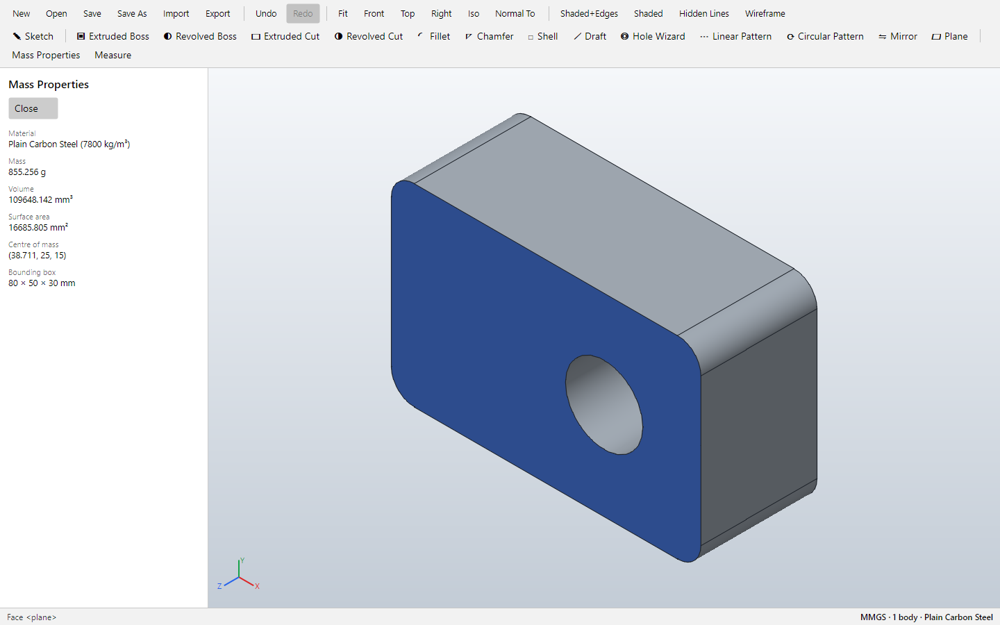
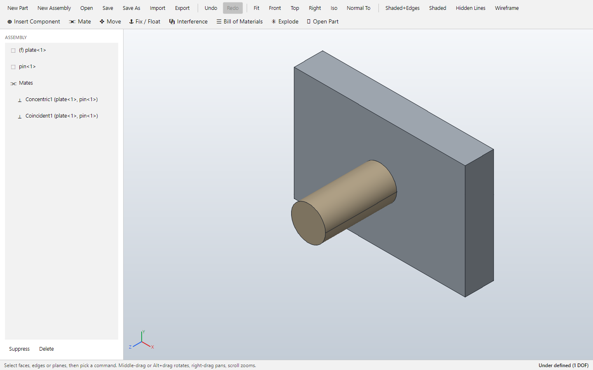
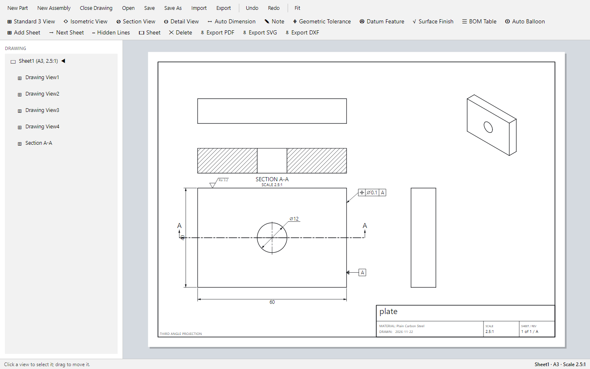
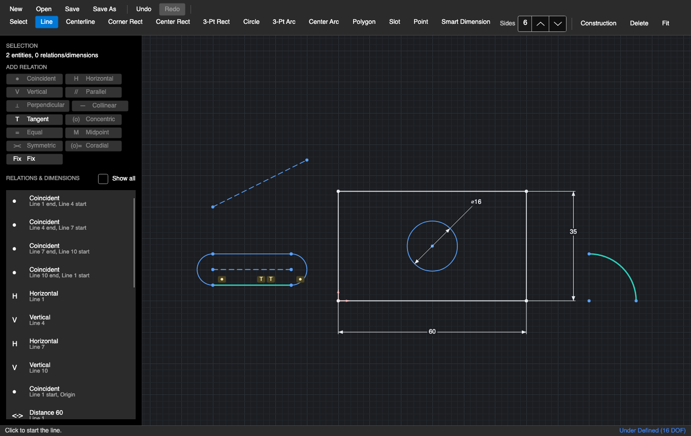

# Chamfer

**Chamfer** is a cross-platform, parametric, feature-based 3D CAD application written in C# with [Avalonia UI](https://avaloniaui.net/). It runs natively on **Windows** and **macOS**. The long-term goal is feature parity with SolidWorks for mechanical design: sketching, part modeling, assemblies, drawings, and the specialized toolsets built on them.

[](LICENSE)

> **Status:** Pre-alpha. You can model real parts, put them together, draw, analyse and render them. Sketches have trim, extend, offset, mirror, fillet, patterns, DXF import and 3D sketches. Parts support extrude, revolve, sweep, loft, rib, fillet, chamfer, shell, draft, Hole Wizard, threads, linear/circular/sketch/table/curve/fill patterns, surfaces, multibody tools, sheet metal (flanges, hems, tabs, flat patterns) and weldments (members, cut lists, end caps, gussets), plus equations, configurations, design tables and custom properties. Assemblies have standard, advanced and mechanical mates, component patterns, assembly cuts, motion studies, interference checks, BOMs, exploded views and Pack and Go. Drawings have standard, section and detail views, associative dimensions, GD&T, BOM, hole and revision tables, and PDF/SVG/DXF export. Simulation covers static stress, natural frequencies, buckling and steady heat flow, and Render path-traces the model. See the [Roadmap](#roadmap).









> **Name:** A *chamfer* is a beveled edge, one of the first features every CAD user learns. The name is short, it's a real CAD term, and it doesn't borrow anyone's trademark.

---

## Table of Contents

- [Goals](#goals)
- [Non-Goals](#non-goals)
- [Tech Stack](#tech-stack)
- [Architecture](#architecture)
- [Solution Layout](#solution-layout)
- [Getting Started](#getting-started)
- [Native File Format](#native-file-format)
- [Roadmap](#roadmap)
- [Feature Parity Matrix](#feature-parity-matrix)
- [Key Technical Risks](#key-technical-risks)
- [Legal & Trademark Notes](#legal--trademark-notes)
- [Contributing Conventions](#contributing-conventions)

---

## Goals

1. **Parametric, history-based modeling.** Every model is a reproducible tree of features driven by sketches, dimensions, equations, and constraints. Editing any upstream feature rebuilds everything downstream.
2. **Feels familiar to SolidWorks users.** A FeatureManager-style tree, a PropertyManager-style panel for editing features, a CommandManager-style ribbon, mouse gestures, and shortcuts that match what people already know. The UI and art are our own.
3. **Truly cross-platform.** One codebase. Windows (x64, ARM64) and macOS (Apple Silicon, Intel) are first-class targets. Linux works as a side effect of the stack and is not officially supported.
4. **Robust geometry.** An industrial-grade B-rep kernel with exact NURBS surfaces, not a mesh modeler.
5. **Open interchange.** First-class STEP, IGES, STL, 3MF, DXF/DWG, and PDF support.
6. **Extensible.** A public C# API and plugin model (the equivalent of the SolidWorks API and add-ins), plus scripting for macros.

## Non-Goals

- Opening native `.SLDPRT`, `.SLDASM`, or `.SLDDRW` files. These formats are proprietary and undocumented, so we interoperate through STEP and other neutral formats instead.
- Copying the SolidWorks UI pixel-for-pixel or using any of its icons, artwork, or documentation.
- A cloud or browser-first product. Chamfer is a desktop application first.

---

## Tech Stack

| Layer | Choice | Notes |
|---|---|---|
| Language | **C# 14 / .NET 10 (LTS)** | Move to the next LTS when it ships. Nullable reference types on, warnings as errors. |
| UI framework | **Avalonia UI** (latest stable) | MVVM with **CommunityToolkit.Mvvm**. Docking via **Dock.Avalonia**. |
| Geometry kernel | **Open CASCADE Technology (OCCT)** | Industrial B-rep/NURBS kernel (LGPL-2.1 with exception). Reached through a thin C ABI shim (`Chamfer.Kernel.Native`) and P/Invoke, because C++/CLI is Windows-only. |
| 3D rendering | **Portable software rasterizer** (`Chamfer.Viewport`) | Multithreaded z-buffer renderer with face and overlay ID buffers for pixel-exact picking; runs on every platform and headless ([ADR 2](docs/adr/0002-software-renderer-first.md)). A GPU backend (GL/Metal/Vulkan) will consume the same backend-neutral `Scene`. |
| Sketch constraint solver | **Custom C# solver** | Newton/Dog-Leg/Levenberg-Marquardt over a sparse Jacobian. FreeCAD's PlaneGCS serves as a reference design. |
| Math | **System.Numerics** + **MathNet.Numerics** | Double-precision types of our own for geometry. Never `float` in model space. |
| Serialization | **System.Text.Json** + ZIP container | See [Native File Format](#native-file-format). |
| Undo/redo | Command pattern over the document model | Every user operation is a reversible transaction. |
| Testing | **xUnit**, **Verify** (snapshot tests), **Avalonia.Headless** | Geometry regression tests compare volume, area, topology counts, and bounding boxes. |
| Packaging | Windows: **MSIX** / Velopack · macOS: signed and notarized **.app** in a **.dmg** | CI via GitHub Actions on `windows-latest` and `macos-latest`. |
| Scripting / macros | **Roslyn** C# scripting | Records user actions as replayable C# scripts. |

### Why OCCT instead of writing a kernel?

A production B-rep kernel (booleans, fillets, offsets, shelling, sewing, healing) takes decades of engineering. Parasolid and ACIS are commercial and expensive. OCCT is the only mature open-source option, and FreeCAD, KiCad's 3D viewer, and many commercial tools are built on it. We isolate it behind a small C ABI ([ADR 1](docs/adr/0001-geometry-kernel.md)) so we can replace or supplement it later, for example with a commercial kernel for the hardest fillets.

### Why not use WPF or WinUI?

They're Windows-only. Avalonia gives us one XAML-based UI that runs natively on Windows and macOS, renders with Skia, and lets us host our own GPU surface for the 3D viewport.

---

## Architecture

```
┌──────────────────────────────────────────────────────────────────────┐
│                         Chamfer.App (Avalonia)                       │
│  Ribbon · Feature Tree · Property Panel · Docking · Dialogs · Themes │
└───────────────┬───────────────────────────────┬──────────────────────┘
                │ ViewModels (MVVM)             │
┌───────────────▼──────────────┐  ┌─────────────▼──────────────────────┐
│     Chamfer.Viewport         │  │       Chamfer.Commands             │
│  Camera · Picking · Gizmos   │  │  Tools, interactive commands,      │
│  Selection filters · Render  │  │  undo/redo transactions            │
└───────────────┬──────────────┘  └─────────────┬──────────────────────┘
                │                               │
┌───────────────▼───────────────────────────────▼──────────────────────┐
│                          Chamfer.Document                            │
│  Part / Assembly / Drawing documents · Feature tree · Configurations │
│  Parameters & equations · Dependency graph · Rebuild engine          │
└───────┬──────────────────┬────────────────────┬──────────────────────┘
        │                  │                    │
┌───────▼───────┐  ┌───────▼────────┐  ┌────────▼────────┐  ┌──────────────────┐
│Chamfer.Sketching│ Chamfer.Features│ │ Chamfer.Assembly│  │ Chamfer.Drawing  │
│ 2D entities   │  │ Extrude, Revolve│ │ Mates, solver,  │  │ Views, HLR, dims,│
│ Constraint    │  │ Fillet, Shell,  │ │ components, BOM │  │ annotations, BOM │
│ solver        │  │ Patterns, ...   │ │                 │  │                  │
└───────┬───────┘  └───────┬────────┘  └────────┬────────┘  └────────┬─────────┘
        └──────────────────┴────────┬───────────┴────────────────────┘
                     ┌──────────────▼──────────────┐
                     │      Chamfer.Geometry       │  Kernel-agnostic interfaces:
                     │  IShape, IFace, IEdge, ...  │  B-rep, curves, surfaces,
                     │  Tessellation, Topology IDs │  booleans, measure
                     └──────────────┬──────────────┘
                     ┌──────────────▼──────────────┐
                     │   Chamfer.Kernel.Occt (C#)  │  P/Invoke bindings, SafeHandles
                     ├─────────────────────────────┤
                     │ Chamfer.Kernel.Native (C++) │  Flat C ABI over OCCT
                     ├─────────────────────────────┤
                     │   Open CASCADE (OCCT)       │
                     └─────────────────────────────┘
```

### Core design principles

- **Document model is UI-agnostic.** `Chamfer.Document` and everything below it have no Avalonia dependency, so they can run headless for tests, batch jobs, and the plugin API.
- **Persistent topological naming.** References to faces and edges, like "fillet this edge," must survive rebuilds. This is the hardest problem in parametric CAD. We'll assign stable IDs from feature-generation history (similar to OCCT's `TNaming`/OCAF ideas, or the approach FreeCAD 1.0 uses), and we test it heavily from day one.
- **Rebuilds are incremental and off the UI thread.** A dependency graph decides what's dirty. Rebuilds run on a background worker, and the viewport shows the last good state until a rebuild completes.
- **Everything is a transaction.** Undo/redo, macro recording, and the API all go through the same command layer.
- **Double precision everywhere in model space.** The renderer uses camera-relative coordinates to avoid float jitter on large assemblies.

---

## Solution Layout

Planned layout. Projects marked ✅ exist today; the rest arrive with later phases.

```
chamfer/
├── src/
│   ├── Chamfer.App/              # Avalonia desktop app (entry point) ✅
│   ├── Chamfer.UI/               # Reusable controls, themes, icons, ribbon
│   ├── Chamfer.Viewport/         # Camera, scene, software renderer, picking ✅
│   ├── Chamfer.Commands/         # Interactive tools & undoable commands
│   ├── Chamfer.Document/         # Part document, features, rebuild engine, naming ✅
│   ├── Chamfer.Sketching/        # 2D sketch entities + constraint solver ✅
│   ├── Chamfer.Assembly/         # Components, mates, assembly solver, BOM ✅
│   ├── Chamfer.Drawing/          # 2D drawings, views, dimensions, PDF/SVG/DXF ✅
│   ├── Chamfer.Simulation/       # Linear static FEA on voxel meshes ✅
│   ├── Chamfer.Geometry/         # Kernel-agnostic math and mesh types ✅
│   ├── Chamfer.Kernel.Occt/      # C# bindings to the native shim ✅
│   ├── Chamfer.Kernel.Native/    # C++ shim over OCCT (CMake) ✅
│   ├── Chamfer.IO/               # STEP, IGES, STL, 3MF, DXF, PDF, native format
│   └── Chamfer.Api/              # Public plugin / scripting API ✅
├── tests/
│   ├── Chamfer.Sketching.Tests/   ✅
│   ├── Chamfer.Kernel.Tests/      ✅
│   ├── Chamfer.Document.Tests/    ✅
│   ├── Chamfer.Viewport.Tests/    ✅
│   ├── Chamfer.Assembly.Tests/    ✅
│   ├── Chamfer.Drawing.Tests/     ✅
│   ├── Chamfer.Simulation.Tests/  ✅
│   ├── Chamfer.IO.Tests/
│   └── Chamfer.App.Tests/        # Avalonia.Headless UI tests ✅
├── samples/                      # Example parts, assemblies, drawings
├── docs/                         # Architecture decision records, specs, images ✅
├── build/                        # OCCT + native shim build scripts ✅; packaging later
├── .github/workflows/            # CI for Windows + macOS ✅
└── Chamfer.slnx
```

---

## Getting Started

### Prerequisites

| | Windows | macOS |
|---|---|---|
| .NET SDK | 10.0+ | 10.0+ |
| IDE (suggested) | Rider, Visual Studio, or VS Code + C# Dev Kit | Rider or VS Code + C# Dev Kit |

| C++ toolchain | Visual Studio 2022+ with the C++ workload | Xcode command-line tools |
| CMake | 3.24+ (bundled with Visual Studio) | 3.24+ (`brew install cmake`) |

### Build & run

The geometry kernel is native code. Build it once (the first build compiles OCCT 7.9.3 from source, which takes 10–40 minutes), then use `dotnet` as usual:

```bash
git clone https://github.com/asofianidis/chamfer.git
cd chamfer
# rid: win-x64, osx-arm64 or osx-x64. The second argument is where OCCT gets installed.
build/native/build-native.sh win-x64 artifacts/occt/win-x64     # use Git Bash on Windows
dotnet run --project src/Chamfer.App
```

The script stages `chamfer_kernel` and the OCCT libraries in `artifacts/native/<rid>/`, and the build copies them next to the app. Set `CMAKE` if `cmake` isn't on your `PATH`.

### Run tests

```bash
dotnet test
```

The tests use [Microsoft.Testing.Platform](https://aka.ms/dotnet-test-mtp) (opted in via `global.json`). `Chamfer.App.Tests` renders the main window headlessly and drives a sketch → extrude → fillet workflow. Set `CHAMFER_SCREENSHOT_DIR` to a folder to save PNG screenshots of the window and of the 3D renderer.

### Modelling a part

| Action | How |
|---|---|
| Sketch | Select a plane (in the tree or the view) or a planar face, then **Sketch**. With nothing selected, Chamfer asks you to pick one. **Exit Sketch** returns to 3D. Double-click a sketch to edit it. |
| Extrude / revolve | With a sketch selected (or just after exiting one), click **Extruded Boss**, **Extruded Cut**, **Revolved Boss** or **Revolved Cut**. Revolves use the sketch's first centerline as the axis. |
| Dress-up features | Select edges or faces, then **Fillet** or **Chamfer**. Select faces to remove, then **Shell**. **Draft** takes a neutral plane and faces. |
| Holes | Select a planar face and click **Hole Wizard**. Place points for the hole centres, exit the sketch, then pick the type and ISO size. |
| Drag handles | While editing an extrusion, drag the orange arrow at its end to set the depth; the Depth field follows. |
| Patterns and mirror | Select features in the tree, then **Linear Pattern**, **Circular Pattern** or **Mirror**, and pick a direction, axis or plane in the view. **Sketch Pattern** copies to a sketch's points, **Table Pattern** to typed X,Y offsets, **Curve Pattern** along a sketched path (evenly or by spacing, optionally turning with it) and **Fill Pattern** over a selected face on a square or staggered grid. |
| Property panel | Changes preview live. Type values or expressions (`25.4*2`, `1in`) and press Enter. Click a selection box to make it active, then pick in the view; Ctrl/⌘-click or Shift-click adds and removes. **OK** (Enter) or **Cancel** (Esc). |
| Feature tree | Double-click to edit. **Suppress**, **Delete** (with dependents), **Roll Here** and **Roll Forward** act on the selected feature. Errors are red, warnings amber. |
| 3D annotations | **3D Annotations** shows the part's overall sizes and hole callouts (grouped by size, e.g. 4× Ø6 THRU) on the model, in the document's units. |
| Render | **Render** path-traces the current view: metals glossy, wood matte, other materials as coated plastic, with a soft sun, sky light and a shadow-catching floor. Pick the quality, then **Render** and **Save PNG**. Click the view to return to the live model. |
| Analysis | **Section** cuts the part with the Front, Top or Right plane (offset, flip) and shows the cut faces. **Draft Analysis** colours faces green, red or yellow by draft against a pull direction. **Zebra** shows stripes for judging surface smoothness. |
| View | Middle-drag (or Alt+drag) rotates about the point under the cursor; Ctrl+middle-drag, right-drag or Alt+Shift+drag pans; the wheel zooms at the cursor. **F** fits. Ctrl/⌘+1 to 8 are Front, Back, Left, Right, Top, Bottom, Isometric and Normal To; arrow keys rotate 15° (with Shift, 90°). |
| Vault | **Vault** treats the file's folder as a vault: check the file out (others can't), check it in with a comment to record the next revision letter, see the history and restore any revision, and see which assemblies and drawings use it. |
| Language | **Language** shows command and tab names in German, French or Spanish (or set `CHAMFER_LANG`); the choice is remembered. |
| Shortcuts | **F6** and **Shift+F6** move keyboard focus between the feature tree, the property panel and the view. **Ctrl+K** finds any command by name. **F1** lists the shortcuts; add or change one as `Ctrl+Shift+H = Hole Wizard` (leave the command empty to remove it). Custom shortcuts are saved with your settings. |
| Templates and library | **Templates** saves the current part (units, material, properties, features) as a template and starts new parts from templates. **Library** lists the parts in the design library folder: open them in part mode, or insert them in an assembly; add the current part to it by name. Select features in the tree and save them as a **library feature** (with their sketches); insert it later onto a selected face or plane. |
| Units | **Units** switches the part between MMGS, CGS, MKS and IPS. Lengths show in that unit everywhere (fields, sketch and drawing dimensions); type a bare number in the document unit or add a unit (25mm, 1in, 2.5cm). |
| Properties | **Properties** holds custom properties as Name = value; values can use {Mass}, {Volume}, {Material}, {Configuration}, other properties and global variables. Description and PartNumber show in assembly BOMs and drawing title blocks. |
| Evaluate | **Mass Properties** uses the part material (pick it under the tree). **Measure** shows sizes and the minimum distance between two selected faces or edges. |
| Files | Parts save as `.chprt`. **Import** brings in STEP or IGES as a body; **Export** writes STEP, IGES, STL, 3MF, OBJ, glTF (.glb), or a self-contained 3D web page (.html) that anyone can open in a browser to orbit and zoom the model. |
| Sketch tools | **Trim** (click the piece to remove), **Extend**, **Fillet** and **Chamfer** (click a corner; Size sets the radius or distance), **Offset** (selected curves, by Size; Reverse flips the side), **Mirror** (selection about a selected centerline), **Linear/Circular Pattern** (Count copies), **Convert Entities** (click model edges behind the sketch), **Convert Face** (outline of the sketch face) and **Import DXF** (lines, arcs, circles and polylines from a DXF file, converted to mm). **Make Block** groups the selection (it then selects as one), **Copy Block** places a copy with its relations beside it, **Explode Block** ungroups. |
| Advanced features | **Helix** on a sketch circle (pitch, height, handedness) is a sweep path for springs. **3D Sketch** is a polyline or spline through typed points (x,y,z, or @dx,dy,dz relative), also usable as a sweep path. **Thread** models an ISO metric thread on a selected cylindrical face (pitch defaults to coarse). **Swept Boss/Cut**: select the profile sketch, then the path sketch, helix or 3D sketch. **Lofted Boss/Cut**: select profile sketches in order. **Rib**: an open sketch line between walls. **Dome** raises (or sinks) a spherical cap on a flat face, following its outline. Extrude also offers **Up To Surface**, **Offset From Surface**, a draft angle and thin walls. |
| Equations | **Equations** defines global variables (`Width = 40`, `Wall = Width / 20`). Type `=Width/2` in any number box or sketch dimension to link it. |
| Configurations | **Configurations** adds variants that override variables and suppression; switch them above the tree. Design tables import and export as CSV (`Configuration, Width, $STATE@Cut-Extrude1`). |
| Surfaces | The **Surfaces** tab has extruded, revolved, planar, filled, swept and offset surfaces, plus **Knit** (sews surfaces, and closed ones become solids), **Thicken**, **Delete Face** (removes holes, fillets or bosses and heals the gap) and **Cut With Surface** (removes the material on one side of a surface body or plane). |
| Sheet metal | The **Sheet Metal** tab: **Base Flange** from a sketch (closed makes a plate, open lines make a bent sheet with the bend radius), **Edge Flange** on straight edges (length, angle, either direction), **Hem** (closed, or open with a gap), **Sketched Bend** (fold along a sketched line), **Dimple** (round formed bumps at sketch points), **Tab** (flat sheet from a sketch on the sheet face), **Flatten** to see the blank with bend lines, and **Export Flat DXF**. |
| Simulation | The **Simulation** tab: select faces and click **Fixture**, **Force** (normal or along an axis) or **Pressure**, then **Run Study**. **Frequency** finds the first four natural frequencies with the same fixtures and plots each mode shape. **Buckling** gives the load factors at which the static loads would buckle the part. For heat, put **Temperature**, **Heat Power** or **Convection** on faces and **Run Thermal** for the steady-state temperature plot and the heat flow. The static plot shows the part deformed and coloured by von Mises stress, with max stress, max displacement and factor of safety against the material's yield strength. |
| Macros | **Macro** opens a C# editor. Scripts get `Api` (sketch builders, `Extrude`, `FilletEdges`, `Variable`, `Link`, queries and export) and `Print`. **Record** captures what you do as a replayable macro; **Open/Save Macro** use `.csx` files. |
| Plugins | .NET assemblies in `plugins/` next to the app (or `%APPDATA%/Chamfer/plugins`) implementing `IChamferPlugin` can add commands; they appear under a **Plugins** tab. |
| Weldments | Sketch centre lines, then **Structural Member** (profile and size from the library, rotation). Each line becomes a body and corners are mitred; optional **end caps** close free ends and **gussets** brace the corners. **Cut List** groups members by profile and length. **Pipe Route** sweeps a pipe, tube (wall) or rod along 3D points with bends of a set radius; its name carries the centreline length. |
| Mold tools | The **Mold Tools** tab: **Parting Lines** selects the edges where faces turn from the pull direction, **Draft Check** colours faces by draft, and **Tooling Split** builds Core and Cavity blocks around the part from a flat parting plane (margin, shrinkage). |
| Bodies | The **Bodies** tab has **Combine** (add, subtract, common), **Split** with a plane, **Move/Copy Body**, **Scale** (about the centroid or origin), **Import Diagnostics** and **Heal** (sew gaps, repair faces, close shells into solids), **Recognize Holes** (an imported body's round through holes become editable Hole features), **Delete/Keep Body** and **Appearance** (body colours). Pick bodies by clicking any of their faces. |

### Assemblies

| Action | How |
|---|---|
| Start | **New Assembly**, then **Insert Component** for saved parts. The first component is fixed. |
| Mate | Select a face or edge on each of two components, then **Mate**. The panel suggests a type (coincident, concentric, distance, angle, parallel, perpendicular, tangent, lock) and alignment, and previews live. Advanced types: **Symmetric** (third entity is the symmetry plane), **Width** (tab faces first, slot faces third and fourth), **Limit Distance/Angle** (minimum and maximum), **Gear** (ratio), **Rack Pinion** (mm per radian) and **Screw** (pitch). The status bar shows the remaining degrees of freedom. |
| Mate references | In a part, select faces and click **Mate Reference** (name it; cylinders mate concentric, flat faces coincident). Inserting a part into an assembly mates it to a component with a reference of the same name whose faces aren't mated yet. |
| Assembly features | **Assembly Cut** removes a circle or rectangle profile (on an assembly origin plane, through all or to a depth) from the chosen components, in the assembly only; the part files don't change. It appears under Assembly Features in the tree, where it can be suppressed or deleted. |
| Patterns | Select a component, then **Linear Pattern** (direction, spacing, instances) or **Circular Pattern** (axis, instances). Copies are locked to the seed. |
| Move | **Move** translates or rotates the selected component; **Fix / Float** toggles whether it can move. |
| Motion | **Motion Study**: pick a face or edge on the component to drive, choose a rotary (rpm) or linear (mm/s) motor and a duration, then **Calculate**. Scrub with **Time** or **Play** the animation; **Detect collisions** reports the first new contact. |
| Evaluate | **Interference** lists overlapping components and volumes; **Bill of Materials** lists parts (by PartNumber and Description when set), quantities and masses; **Pack and Go** copies the assembly and its parts to one folder; **Import STEP** turns a STEP assembly into part files (with names and colours) and an assembly; **Explode** spreads the components apart. |
| Edit parts | **Open Part** edits the selected component's part; **Back to Assembly** returns. |
| Toolbox | **Toolbox** inserts ISO socket head cap screws, hex bolts, nuts and washers (M3 to M20, standard lengths). They're generated parts, and the BOM lists them by standard. |

### Drawings

| Action | How |
|---|---|
| Start | With a part or assembly open, **New Drawing** creates a sheet with front, top, right and isometric views at a fitting standard scale. **Add Sheet** and **Next Sheet** handle multiple sheets. |
| Assemblies | **BOM Table** adds a bill of materials; **Auto Balloon** numbers each distinct part in the selected (or isometric) view to match it. |
| Views | Select a view, then **Section View** (horizontal or vertical cut, hatched) or **Detail View** (magnified circle). Drag views to move them. **Hidden Lines** toggles hidden edges. |
| Annotate | **Auto Dimension** adds overall sizes and hole diameters to the selected view, tied to model edges, so they update when the part changes. **Note** adds text. **Hole Table** lists the selected view's holes with tags and X/Y from its lower-left corner; **Add Revision** adds a row to the revision table and updates the title block. **Geometric Tolerance** builds a feature control frame (characteristic, tolerance, Ø, MMC/LMC, datums): click the feature, then where the frame goes. **Datum Feature** and **Surface Finish** place those symbols the same way. **Sheet** sets the drafting standard (ISO first-angle or ANSI third-angle with horizontal dimension text), size, scale, projection angle and title block fields. **Layers** adds coloured layers, shows or hides them, and picks the active layer for new notes and annotations; layers export to DXF. |
| Export | **Export PDF**, **SVG** or **DXF**. Drawings save as `.chdrw`. |

### Using the sketcher

| Action | How |
|---|---|
| Draw | Pick a tool from the toolbar: **L** line, **R** corner rectangle, **C** circle, **A** 3-point arc, **G** polygon, **T** slot, **P** point. Click to place points; click-drag-release also works. |
| End a line chain or cancel | **Esc** cancels and returns to Select. **Enter** or right-click finishes a line chain. |
| Automatic relations | Snapping to points, midpoints, lines, and circles adds coincident, midpoint, and on-curve relations. Lines within 3° of horizontal or vertical snap to it. |
| Dimension | **D** (Smart Dimension): pick one or two entities, then click to place. For a line or two points, placing the label above or below gives a horizontal dimension, left or right a vertical one, anywhere else an aligned one. Type a value or an expression (`25.4*2`, `1in`) and press Enter. Double-click a dimension to edit it. |
| Add relations | Select entities, then use **Add Relation** in the side panel. Only relations that fit the selection are enabled. |
| Edit | Drag geometry to move it; the solver keeps every relation. **X** toggles construction, **Delete** deletes, **Ctrl/⌘+Z** undoes. |
| Navigate | Mouse wheel zooms (on macOS, scroll pans and pinch zooms). Middle- or right-drag pans. **F** fits the sketch in view. |
| Status | Blue = under-defined, black/white = fully defined, red = over-defined. The status bar shows the remaining degrees of freedom. |
| Files | Sketches save as `.chsk` (JSON). |

---

## Native File Format

Today a part is a single JSON document (`.chprt`): format version, material, rollback position and the ordered feature list, with each sketch embedded in its own JSON format and imported bodies stored as OCCT BRep text. The ZIP container below is the planned layout once drawings, assemblies and caches arrive:

| Extension | Type |
|---|---|
| `.chprt` | Part |
| `.chasm` | Assembly |
| `.chdrw` | Drawing |

```
part.chprt (zip)
├── manifest.json          # format version, app version, document type, units
├── features.json          # feature tree: ordered features, parameters, references
├── sketches/*.json        # sketch entities + constraints
├── parameters.json        # global variables, equations, configurations
├── cache/body.brep        # last-rebuilt B-rep (optional; speeds up open)
├── cache/display.bin      # tessellated mesh for fast preview (optional)
└── thumbnail.png
```

The feature tree is the source of truth. The B-rep cache can always be regenerated. The format is versioned, with forward migrations from day one.

---

## Roadmap

The roadmap is organized into milestones. Each one produces something usable and testable. The phases build on each other, roughly in the order a SolidWorks user would learn the product.

Legend: `[ ]` not started · `[~]` in progress · `[x]` done

### Phase 0: Foundations
*Goal: an empty app that opens on both platforms with a working 3D viewport and a geometry kernel wired up.*

- [x] Solution scaffolding, `Directory.Build.props`, central package management, `.editorconfig`, analyzers
- [x] CI on GitHub Actions: build and test on Windows and macOS
- [x] Native shim (`Chamfer.Kernel.Native`) with CMake over OCCT 7.9.3 *(win-x64 and osx-arm64 in CI; win-arm64 and osx-x64 build with the same script)*
- [x] P/Invoke layer with `SafeHandle` lifetime management; kernel tests cover primitives, booleans, fillets, shells, sweeps, lofts and file exchange
- [x] Avalonia shell: main window, docking layout, ribbon placeholder, dark/light themes *(command bar, feature tree, property panel and themes; a resizable side panel docked left or right, hidden with F9, remembered)*
- [x] 3D viewport: camera (orbit about the cursor, pan, zoom at the cursor, zoom-to-fit), axis triad, standard views, perspective *(view cube not yet)*
- [x] Tessellation pipeline: B-rep → mesh with per-face triangles and edge polylines; shaded, shaded-with-edges, wireframe, and hidden-lines-removed modes
- [x] Picking: ID buffers for faces, edges, sketches and planes; hover highlight; selection set
- [x] Undo/redo transaction framework *(snapshot-based, for parts and sketches)*
- [x] Architecture decision records ([kernel](docs/adr/0001-geometry-kernel.md), [renderer](docs/adr/0002-software-renderer-first.md), [topological naming](docs/adr/0003-persistent-naming.md))

### Phase 1: Sketcher (MVP)
*Goal: fully constrained 2D sketches on a plane, at the level of the SolidWorks sketcher.*

- [x] Sketch on standard planes, reference planes and planar faces *(edited normal to the plane with the part drawn behind)*
- [x] Entities: line, centerline, rectangle (corner, center, 3-point), circle, arc (center, tangent, 3-point), polygon, slot, ellipse, spline, point
- [x] Constraint solver: coincident, horizontal, vertical, parallel, perpendicular, tangent, concentric, equal, midpoint, symmetric, fix, collinear, coradial
- [x] Smart Dimension: linear, angular, radial, diameter, driven/driving
- [x] Degrees-of-freedom display: under-, fully, and over-defined coloring
- [x] Inference lines and automatic relations while drawing *(snap relations, horizontal/vertical inference, and dotted inference lines to points the cursor lines up with)*
- [x] Trim, extend, offset, mirror, fillet, chamfer, linear and circular sketch patterns
- [x] Convert entities, intersection curves *(model edges, face outlines, and where the sketch plane cuts the model, as fixed geometry)*
- [x] Construction geometry
- [x] Sketch blocks *(make, select as one, copy with their relations, explode; saved with the sketch)*
- [x] Units, document properties, and dimension display settings *(MMGS/CGS/MKS/IPS per part; values typed with any unit suffix; fixed decimal places for parts and drawings)*

**How the sketcher works.** Each entity is a set of parameters (coordinates and radii). Each relation or dimension is one or more equations with exact derivatives, and every derivative is checked against finite differences in the tests. A Levenberg–Marquardt solver takes minimum-norm steps, so geometry the constraints don't pin down stays where you left it. Dragging uses a weighted version of the same step, so the dragged point gives way last. The status (under-, fully, or over-defined) comes from the rank of the constraint Jacobian, computed with Gram–Schmidt orthogonalization in the order relations were added. That pinpoints which relation made the sketch redundant and which parameters are still free.

### Phase 2: Core Part Modeling
*Goal: model the typical machined part end to end.*

- [x] Feature tree panel with rollback bar, suppress/unsuppress, reorder, rename, and folders
- [x] Property panel framework for every feature, with live preview
- [x] **Extruded Boss/Base** and **Extruded Cut**: blind, through all, up to vertex, surface, or offset, mid-plane, two-direction, draft, thin feature *(up to vertex stops at a reference point's parallel plane)*
- [x] **Revolved Boss** and **Revolved Cut** *(one direction and mid-plane)*
- [x] **Fillet**: constant radius, variable radius, face fillet, full round
- [x] **Chamfer**: distance-distance, distance-angle, vertex
- [x] **Shell**, **Draft**, **Rib**
- [x] **Hole Wizard**: counterbore, countersink, tapped, and pipe tap, with ANSI and ISO standards tables *(ISO metric and ANSI inch (UNC) sizes with 90°/82° countersinks; NPT pipe taps as 1:16 tapered holes)*
- [x] **Linear Pattern**, **Circular Pattern**, **Mirror** *(of boss, cut, hole and pattern features)*
- [x] Reference geometry: planes, axes, coordinate systems, points *(offset, angled and three-point planes; axes along edges/cylinders, between planes or points; points at coordinates or on the model; coordinate systems for mass properties)*
- [x] Persistent topological naming that survives parameter edits *(history-based names with geometric fallback)*
- [x] Rebuild engine with error and warning reporting ("What's Wrong") *(incremental: unchanged prefixes are reused)*
- [x] Materials and mass properties: mass, volume, center of mass, moments of inertia
- [x] Measure tool *(sizes, radii, minimum distance)*
- [x] Native file save/open (`.chprt`)
- [x] STEP, IGES, and STL export; STEP and IGES import as dumb solids

### Phase 3: Advanced Part Modeling
- [x] **Swept** Boss and Cut (with guide curves, twist) *(profile along a path with sharp or smooth corners, an even twist, or scaled to follow a guide curve)*
- [~] **Lofted** Boss and Cut (guide curves, centerline, start/end constraints) *(smooth or ruled through any number of profiles, with normal-to-profile start and end constraints; guide curves not yet)*
- [~] **Boundary** Boss and Cut *(boss, cut and surface through profiles in order, leaving and meeting the end profiles normal with a tangent length; direction-2 curves not yet)*
- [~] 3D sketches *(polylines and splines through typed points, absolute or relative; usable as sweep paths)*
- [x] Curves: helix and spiral, projected, composite, curve through points, split line *(helix; sketch projected onto a face; composite of joined curves; curves through points as 3D sketch splines; split line; all usable as sweep paths)*
- [x] Multibody parts: combine, intersect, split, move/copy body, delete body
- [x] **Global variables and equations**
- [x] **Configurations**, then **design tables** (spreadsheet-driven configurations)
- [x] Curve-driven, sketch-driven, table-driven, fill, and variable patterns
- [x] Wrap, dome, flex, deform, indent *(wrap onto cylinders, dome, flex (twisting, tapering, stretching), point deform, indent with clearance)*
- [x] Cosmetic threads, thread feature *(cosmetic threads on shafts and holes, shown in drawings and the 3D view; modelled ISO metric threads, external and internal)*
- [x] Library features *(save sketches and the features on them; insert onto any face or plane)*
- [~] Appearances, decals, scenes *(body colours; render scenes: daylight, studio, sunset, overcast; decals not yet)*
- [x] Section view, display states *(section view with capped cut faces; hide/show components and named display states in assemblies)*
- [x] Interactive feature editing via drag handles (Instant3D-style) *(drag arrows to set extrusion and hole depths, fillet radii, chamfer distances and shell thickness)*

### Phase 4: Assemblies
- [x] Assembly document (`.chasm`), insert components, subassemblies *(rigid subassemblies: mate to their faces, one BOM line, edit in place, nested Pack and Go)*
- [x] Assembly solver for 3D mate constraints *(Levenberg–Marquardt over component placements, with DOF from the Jacobian rank and conflict reporting)*
- [x] **Standard mates**: coincident, parallel, perpendicular, tangent, concentric, lock, distance, angle
- [x] **Advanced mates**: limit distance and angle, width, symmetric, path, linear/linear coupler *(plus slot)*
- [x] **Mechanical mates**: gear, rack and pinion, cam, hinge, screw, universal joint, slot
- [~] Mate references, SmartMates (drag-to-mate) *(mate references applied on insert; Quick Mate picks the obvious mate for two selected faces; drag-onto-face mating not yet)*
- [x] Move and rotate component with collision detection *(drag in the view within the mates; numeric move/rotate, optionally stopping at collisions)*
- [x] Interference detection, clearance verification *(interference volumes; pairs closer than a minimum gap, with their distance)*
- [x] Exploded views and explode lines *(automatic radial explode, manual explode steps along an axis, dashed explode lines, collapse)*
- [~] Component patterns, mirror components *(linear and circular component patterns; mirror as an opposite-hand copy or a turned-over symmetric part)*
- [~] In-context (top-down) design with external references *(sketch on another component's face into a new or existing part, kept up to date as the source changes or moves; lock and break references)*
- [x] Assembly features: cuts and holes *(assembly cuts and holes: circle or rectangle profiles, plain, counterbored or countersunk, through all or to a depth, per component)*
- [x] Bill of Materials data model
- [~] Large-assembly mode: lightweight components, LOD, instancing, frustum culling *(instanced component meshes, frustum culling)*
- [x] Pack and Go *(copy an assembly and its parts to one folder with prefix/suffix, optional zip)*

### Phase 5: Drawings
- [x] Drawing document (`.chdrw`), sheets, sheet formats, title blocks *(A4–A0, Letter, Tabloid; multiple sheets; editable title block fields; part and assembly drawings)*
- [x] Hidden-line-removal (HLR) projection engine *(OCCT exact HLR: visible, tangent, silhouette and hidden edges)*
- [~] Standard 3 views, projected, auxiliary, section, detail, broken-out section, break, crop, and alternate-position views *(standard, isometric, projected, auxiliary, section with hatching, detail, broken-out section, break, crop; alternate position not yet)*
- [~] Model items import (dimensions from the model), reference dimensions *(auto overall and hole dimensions anchored to model edges)*
- [x] Ordinate, baseline, and chain dimensions; tolerances and fits *(horizontal, vertical, aligned, diameter, radius; baseline, chain and ordinate sets to hole centres; tolerance text; ISO 286 fits with limits)*
- [x] Annotations: notes, balloons, surface finish, weld symbols, datum feature, datum target
- [x] **GD&T** feature control frames (ASME Y14.5 / ISO 1101) *(all 14 characteristics, Ø zones, MMC/LMC, datum references, datum feature symbols)*
- [x] Centerlines, center marks, cosmetic threads in drawings *(automatic centre marks and centrelines; tapped holes show their thread end-on and side-on)*
- [x] BOM tables, hole tables, revision tables, general tables
- [x] Layers, line styles, drafting standards (ANSI, ISO, DIN, JIS) *(coloured layers with visibility and DXF layers; ISO, ANSI, DIN and JIS with their projection angles)*
- [~] Export to PDF, DXF, DWG, SVG; printing *(PDF, DXF and SVG)*
- [x] Associativity: drawings update when the model changes

### Phase 6: Surfacing
- [x] Extruded, revolved, swept, lofted, and boundary surfaces
- [x] Planar, offset, ruled, and filled surfaces
- [x] Knit (sew), trim, untrim, extend, and delete face *(knit and form solids; trim by a plane; untrim; extend flat surfaces; delete face)*
- [x] Thicken, and thickened cut
- [x] Replace face, cut with surface
- [x] Surface analysis: zebra stripes, curvature, draft analysis, deviation analysis, undercut detection
- [~] Freeform *(flat faces reshaped through a grid of up to 5 x 5 control points pulled in or out, staying on their edges)*

### Phase 7: Specialized Toolsets
**Sheet Metal**
- [~] Base flange, edge flange, miter flange, sketched bend, hem, jog *(base flange from closed or open profiles, edge flanges at any angle either way, sketched bends, closed and open hems, tabs)*
- [x] Bend tables, K-factor, bend allowance and deduction
- [x] Flat pattern and flat-pattern DXF export
- [~] Lofted bends, convert to sheet metal, forming tools *(dimple forming tool)*

**Weldments**
- [x] Structural members from a profile library *(square/rectangular/round tube, angle, UPN channel, IPE beam, flat bar)*
- [~] Trim/extend, end caps, gussets, fillet beads *(automatic mitres at corners, end caps on free ends, corner gussets)*
- [x] Cut lists with properties

**Mold Tools**
- [~] Scale, parting lines, shut-off surfaces, parting surfaces, tooling split, core/cavity *(scale, parting lines, flat-parting tooling split into core and cavity with shrinkage)*

### Phase 8: Data Exchange & Interop
- [~] STEP AP203/AP214/AP242 import and export with colors, names, assembly structure, and PMI where possible *(export and import with product structure, names and colours)*
- [~] IGES, ACIS (`.sat`), Parasolid (`.x_t`, if a licensing path exists), JT *(IGES import and export)*
- [x] STL, 3MF, OBJ, glTF export (for 3D printing and visualization) *(STL, 3MF, OBJ, glTF binary with instancing)*
- [~] DXF/DWG import into sketches *(ASCII DXF: lines, arcs, circles, polylines with bulges, splines as polylines, units)*
- [x] Import diagnostics and healing (gap repair, face healing) *(open/bad/tiny edge and face checks; sewing, ShapeFix and closing shells into solids)*
- [~] FeatureWorks-style feature recognition on imported solids (stretch goal) *(round through holes become Hole Wizard features; Delete Face)*

### Phase 9: Simulation & Motion
- [~] Linear static FEA: tetrahedral meshing via OCCT/Netgen or Gmsh, a solver (CalculiX integration or our own), results plots *(our own solver on a voxel mesh: incompatible-mode hexahedra, matrix-free conjugate gradient, fixtures, forces and pressures, von Mises plots on the deformed shape, factor of safety)*
- [x] Frequency and buckling studies *(natural frequencies and mode shapes; linear buckling load factors from the static stresses)*
- [x] Thermal studies *(steady-state and transient conduction with fixed temperatures, heat power and convection; results at each time step)*
- [~] Motion study: animation timeline, motors, springs, gravity *(rotary and linear motors, kinematic frames, scrubbing and playback)*
- [x] Basic kinematics and interference over time
- [x] Draft-angle and wall-thickness checks for manufacturability *(draft analysis; wall thickness against a minimum, with the thinnest wall)*

### Phase 10: Productivity, Extensibility & Ecosystem
- [x] **Public C# API** (`Chamfer.Api`) and plugin loading via `AssemblyLoadContext`
- [x] Macro recording and playback (Roslyn scripting)
- [x] Toolbox: standard fasteners, bearings, and hardware libraries (ANSI and ISO) *(ISO M3 to M20 and ASME #10 to 1/2 in socket head cap screws, hex bolts, nuts and washers; 60xx/62xx deep groove ball bearings)*
- [~] Design Library, favorites, templates *(part templates; design library folders to open or insert from)*
- [~] Custom properties, property tab builder *(custom properties with {Mass}/{Material}/variable tokens, used by BOMs and title blocks)*
- [~] Photorealistic rendering (path tracer, PBR materials, HDRI environments) *(CPU path tracer: BVH, plastic/metal/matte finishes from the material, soft sun shadows, sky, floor, PNG output)*
- [~] Model-Based Definition (3D PMI) *(3D size dimensions and grouped hole callouts on the model)*
- [~] Routing: piping, tubing, electrical harnesses *(pipe, tube and cable routes along 3D points with bend radii)*
- [~] Basic PDM: check-in/out, revisions, where-used (Git-backed or server-backed) *(folder vault: locks, check-in with revision letters and comments, history and restore, where-used)*
- [~] eDrawings-style lightweight viewer *(export a self-contained HTML/WebGL viewer page)*
- [~] Localization (i18n) *(German, French and Spanish command and tab names; panels still English)*
- [~] Accessibility: keyboard navigation, screen-reader support for panels *(named controls and regions for screen readers; F6 / Shift+F6 move focus between the tree, panel and view)*
- [~] Mouse gestures, customizable shortcuts, customizable ribbon *(customisable shortcuts, command search)*
- [~] Auto-update (Velopack) *(on-request check of GitHub releases; installers not yet)*

### Phase 11: Hardening
- [x] Crash reporting with auto-save and document recovery *(auto-save every 2 minutes, crash log, recovery panel on the next start)*
- [~] Performance budgets: rebuild time, open time, frame time on reference assemblies *(budgets for a 2000-component frame and a 100-hole pattern rebuild)*
- [~] Large-model test suite (10k+ components) *(2000 instanced components build, cull and render under budget)*
- [x] Fuzzing for file importers *(mutated part, sketch, assembly, drawing and DXF files must load or be rejected cleanly)*
- [~] Signed releases, notarization, reproducible builds *(tag-triggered release packages with SHA-256 checksums, signing and notarisation when certificates are configured, deterministic CI builds)*

---

## Feature Parity Matrix

A high-level tracker against SolidWorks capability areas.

| Area | SolidWorks capability | Chamfer phase | Status |
|---|---|---|---|
| Sketching | 2D/3D sketch, relations, dimensions | 1, 3 | 🟩 2D sketching complete; 3D sketches not yet |
| Part features | Extrude, revolve, fillet, chamfer, shell, hole wizard, patterns | 2 | 🟩 Working, with a few options missing |
| Advanced part | Sweep, loft, boundary, multibody, curves | 3 | 🟨 Sweep, loft, rib, multibody |
| Parametrics | Equations, global variables, configurations, design tables | 3 | 🟩 Done |
| Assemblies | Standard, advanced, and mechanical mates; exploded views | 4 | 🟨 Standard, advanced and gear/rack/screw mates, component patterns, BOM, interference, explode |
| Large assemblies | Lightweight, Large Design Review | 4, 11 | ⬜ |
| Drawings | Views, dimensions, GD&T, BOM, tables | 5 | 🟨 Part and assembly drawings, sections, details, dimensions, BOM, balloons, export |
| Surfacing | Surface features, knit, trim, analysis | 6 | 🟨 Core surfaces, knit, thicken |
| Sheet metal | Flanges, bends, flat pattern | 7 | 🟨 Base and edge flanges, sketched bends, hems, tabs, flat pattern, DXF |
| Weldments | Structural members, cut lists | 7 | 🟨 Members, mitres, cut lists |
| Mold tools | Parting line/surface, core/cavity | 7 | ⬜ |
| Data exchange | STEP, IGES, STL, 3MF, DXF/DWG | 2, 8 | 🟨 STEP/IGES in and out; STL, 3MF, OBJ, glTF and HTML viewer out; DXF in and out |
| Simulation | SimulationXpress-level FEA, frequency, thermal | 9 | 🟨 Linear static stress |
| Motion | Motion studies, animation | 9 | ⬜ |
| Rendering | Visualize-style photoreal rendering | 10 | ⬜ |
| MBD | 3D PMI | 10 | ⬜ |
| Routing | Piping, tubing, electrical | 10 | ⬜ |
| Toolbox | Standard hardware library | 10 | 🟨 ISO screws, bolts, nuts, washers |
| API / macros | Programmatic API, macro recorder | 10 | 🟩 C# API, Roslyn macros, recorder, plugins |
| PDM | Vault-style data management | 10 | ⬜ |

---

## Key Technical Risks

| Risk | Impact | Mitigation |
|---|---|---|
| **Topological naming** (references break on rebuild) | Critical: this makes or breaks parametric editing | Design it in Phase 0/2, not later. History-based naming with geometric fallback matching. Large regression suite of "edit upstream, check downstream" tests. |
| **Kernel robustness** (fillets, booleans, shells failing on edge cases) | High | Wrap every kernel call with validation and healing. Collect failing cases as test fixtures. Keep the kernel behind interfaces so it can be swapped. |
| **Native interop on two OSes** (building OCCT and the shim for 4 RIDs) | High in early phases | vcpkg manifest + CMake presets; prebuilt native artifacts cached in CI and shipped in a `runtimes/{rid}/native` NuGet layout. |
| **3D rendering inside Avalonia on macOS** (OpenGL deprecated on macOS) | Medium | Renderer abstraction from day one; GL 4.1 works today on macOS, with Metal or Vulkan/MoltenVK as the planned path. |
| **Scope** (SolidWorks has 30 years of features) | High | Ship the phases in order; each phase must be daily-usable before the next one starts. |
| **Performance** (C# GC pauses during interaction) | Medium | Pooled buffers, `Span<T>`, no allocations in render loops, workstation concurrent GC, profiling in CI. |

---

## Legal & Trademark Notes

- *SolidWorks* is a registered trademark of Dassault Systèmes. Chamfer is an independent project, not affiliated with or endorsed by Dassault Systèmes. "SolidWorks" appears in this repository only to describe compatibility and feature-parity goals.
- No SolidWorks code, icons, artwork, documentation, or file-format reverse engineering is used. All UI assets are original.
- **OCCT** is licensed under LGPL-2.1 with the OCCT exception. We link to it dynamically and ship its license notices.
- Track all third-party licenses in `THIRD-PARTY-NOTICES.md`.
- Project license: **[MIT](LICENSE)**. Third-party components (such as OCCT) keep their own licenses, which are listed in `THIRD-PARTY-NOTICES.md` as they're added.

---

## Security

Please don't report security issues in public issues. Use GitHub's private vulnerability reporting (**Security → Report a vulnerability**) instead.

## Contributing Conventions

> By submitting a contribution, you agree that it's licensed under the project's [MIT License](LICENSE).

- **Branching:** `main` is always green. Work happens on `feature/<short-name>` branches merged through PRs.
- **Commits:** [Conventional Commits](https://www.conventionalcommits.org/) (`feat(sketch): add tangent constraint`).
- **Code style:** enforced by `.editorconfig` and analyzers; `dotnet format` must pass in CI.
- **Tests:** every feature ships with geometry regression tests (volume, area, face/edge counts, bounding box) and at least one rebuild-after-edit test.
- **ADRs:** significant architectural decisions are recorded in `docs/adr/NNNN-title.md`.
